<!--
  Executive Monochrome GitHub Profile README — Muhammad Arsalan Warsi
  Theme: Pure Black, Zinc Grey & Crisp White (#050505 / #09090B / #27272A / #FFFFFF)
-->

  

  

 

<table>
  <tr>
    <td width="220" align="center" valign="middle">
      
        
      
    </td>
    <td valign="middle">
      <h3>Building Products With Clarity</h3>
      

        I am <strong>Muhammad Arsalan Warsi</strong>, a <strong>Full-Stack & Cross-Platform Software Engineer</strong> based in <strong>Karachi, Pakistan</strong>. I architect and ship production-grade Web, Mobile, and Desktop applications focused on clean UI, scalable APIs, and hardened authentication (JWT, Cookies, OTP, Rate Limiting).
      

      <ul>
        <li><strong>Current Role:</strong> Teaching Associate at <strong>Aptech Learning Shahrah-e-Faisal</strong> (MERN, Next.js, TypeScript, Auth Architecture)</li>
        <li><strong>Open Source:</strong> Author of <code>npx create-modern-mern-app@latest</code></li>
        <li><strong>Focus:</strong> Next.js 16, NestJS, Rust, Tauri, Electron, React Native & Scalable Cloud Systems</li>
      </ul>
      

        
        
        
      

    </td>
  </tr>
</table>

<!-- AUTO-STATS:START -->

  
  
  
  

<!-- AUTO-STATS:END -->

  

<h2 align="center">Tech Stack & Ecosystem</h2>

  

  

  

  

<h2 align="center">All Public Repositories (Auto-Updated Live)</h2>

  <em>Automatically synced every 12 hours via GitHub Actions from the GitHub API.</em>

<!-- AUTO-REPOS:START -->
> Run the **Update Dynamic Profile** GitHub Action once to populate all public repositories automatically here.
<!-- AUTO-REPOS:END -->

  

<h2 align="center">Experience, Education & Recognition</h2>

| Role / Credential | Organization | Period | Focus |
| :--- | :--- | :---: | :--- |
| **Teaching Associate** | Aptech Learning Shahrah-e-Faisal | Dec 2025 – Present | MERN Stack, Next.js, JavaScript, JWT, Cookies, OTP Auth & Debugging |
| **Computer Teacher** | Boston Grammar School | Aug 2025 – Dec 2025 | Computer Fundamentals, Programming Basics & Digital Literacy (Grades 3–10) |
| **ACCP Computer Science** | Aptech Learning | 2023 – 2026 | Full-Stack Web Engineering, MERN, PHP & Database Design |
| **Bachelor of Commerce** | University of Karachi | 2023 | 1st Division · Business, Accounting & Analytical Foundations |

  
  
  
  
  

  

<h2 align="center">Live GitHub Telemetry & Analytics</h2>

<!-- Core Stats & Languages (Monochrome) -->

  
  

<!-- Streak Card (Monochrome) -->

  

<!-- Summary Analytics Charts (Monochrome Dark) -->

  

  
  
  

<!-- Contribution Activity Graph (Monochrome) -->

  

<!-- GitHub Trophies (Dark Monochrome) -->

  

<!-- Animated Snake & 3D Contribution Calendar -->

  <picture>
    <source media="(prefers-color-scheme: dark)" srcset="https://raw.githubusercontent.com/MArsalanwarsi/MArsalanwarsi/output/github-contribution-grid-snake-dark.svg" />
    <source media="(prefers-color-scheme: light)" srcset="https://raw.githubusercontent.com/MArsalanwarsi/MArsalanwarsi/output/github-contribution-grid-snake.svg" />
    
  </picture>

  

  

<h2 align="center">Let's Build Something Scalable</h2>

  
  
  

