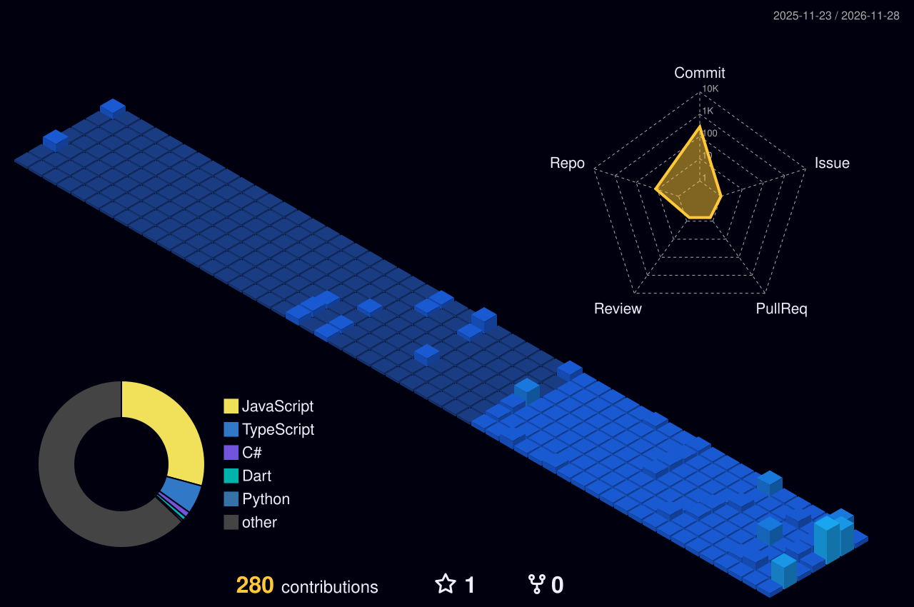

<!--
  Dynamic Executive GitHub Profile README for Muhammad Arsalan Warsi
  Theme: Obsidian & Electric Cyan — synced with arsalanwarsi.vercel.app & LinkedIn
  Profile Repo: https://github.com/MArsalanwarsi/MArsalanwarsi
-->

  

  

  

  
  
  
  
  
  

<!-- AUTO-STATS:START -->

  
  
  
  
  

<!-- AUTO-STATS:END -->

---

<h2 align="center">About Me — Building Products With Clarity</h2>

  I am <strong>Muhammad Arsalan Warsi</strong>, a Full-Stack & Cross-Platform Software Engineer based in <strong>Karachi, Pakistan</strong>. 
  I architect and ship scalable, secure, high-performance web, mobile, and desktop applications with clean UI, readable architecture, production APIs, and authentication systems (JWT, cookies, OTP, rate limiting).

  

---

<h2 align="center">Core Stack & Ecosystem</h2>

  

  

| Layer | Technologies & Tooling |
| :--- | :--- |
| **Web & Frontend** | `Next.js 16` · `React 19` · `TypeScript` · `Redux Toolkit` · `Tailwind CSS` · `shadcn/ui` · `GSAP` · `Recharts` · `Vite` |
| **Mobile & Desktop** | `React Native` · `Flutter` · `Dart` · `Riverpod` · `Tauri` · `Electron` |
| **Backend & Security** | `NestJS` · `Node.js` · `Express.js` · `Rust` · `PHP` · `Laravel` · `ASP.NET MVC` · `Socket.IO` · `JWT` · `OTP` · `Helmet` |
| **Databases & Cloud** | `MongoDB` · `Mongoose` · `MySQL` · `Redis` · `Firebase` · `Cloudinary` · `Gemini API` · `Vercel` · `Netlify` |

---

<h2 align="center">Selected Portfolio Work</h2>

  Synced with <a href="https://arsalanwarsi.vercel.app/">arsalanwarsi.vercel.app</a> — flagship public & private builds.

| # | Project | Category | Core Stack | Links |
| :---: | :--- | :--- | :--- | :---: |
| **01** | **GrowthRadar AI** | AI SaaS Platform | `React 19` `Vite 8` `Node.js` | [Case Study](https://arsalanwarsi.vercel.app/) · [Repo](https://github.com/MArsalanwarsi/growthAi) |
| **02** | **Fitness Tracker Application** | AI Product Build | `React` `Redux Toolkit` `Node.js` `MongoDB` `Gemini API` | [Case Study](https://arsalanwarsi.vercel.app/) · [Repo](https://github.com/MArsalanwarsi/fitness-tracker-React) |
| **03** | **Sustainable Living** | Carbon Tracker App | `Flutter` `Dart` `Provider` | [Case Study](https://arsalanwarsi.vercel.app/) |
| **04** | **Warranty Flow** | Private Flutter Portal | `Flutter` `Dart` `Riverpod` | [Case Study](https://arsalanwarsi.vercel.app/) |
| **05** | **ThriftShoewear Commerce** | Private Commerce Stack | `React 19` `Vite 8` `Node.js` `MongoDB` | [Case Study](https://arsalanwarsi.vercel.app/) · [Repo](https://github.com/MArsalanwarsi/thriftshoewear-dashboard) |
| **06** | **Master Wood Works** | Client PHP Commerce | `PHP` `MySQL` `HTML5` | [Case Study](https://arsalanwarsi.vercel.app/) |
| **07** | **ABC Mall & Cinema System** | ASP.NET MVC System | `ASP.NET MVC` `C#` `HTML/CSS` | [Case Study](https://arsalanwarsi.vercel.app/) |
| **08** | **K-Medicos Medicine Store** | PHP Commerce | `PHP` `MySQL` `HTML5` | [Case Study](https://arsalanwarsi.vercel.app/) · [Repo](https://github.com/MArsalanwarsi/K-Medicos-drug-store-using-PHP-and-MYSQL) |

---

<h2 align="center">All Public Repositories (Auto-Updated Live)</h2>

  <em>Automatically synced every 12 hours via GitHub Actions from the GitHub API.</em>

<!-- AUTO-REPOS:START -->
> Run the **Update Dynamic Profile** GitHub Action once to populate all public repositories automatically here.
<!-- AUTO-REPOS:END -->

---

<h2 align="center">Experience, Education & Recognition</h2>

| Role / Credential | Organization | Period | Focus |
| :--- | :--- | :---: | :--- |
| **Teaching Associate** | Aptech Learning Shahrah-e-Faisal | Dec 2025 – Present | MERN Stack, Next.js, JavaScript, JWT, Cookies, OTP Auth & Debugging |
| **Computer Teacher** | Boston Grammar School | Aug 2025 – Dec 2025 | Computer Fundamentals, Programming Basics & Digital Literacy (Grades 3–10) |
| **ACCP Computer Science** | Aptech Learning | 2023 – 2026 | Full-Stack Web Engineering, MERN, PHP & Database Design |
| **Bachelor of Commerce** | University of Karachi | 2023 | 1st Division · Business, Accounting & Analytical Foundations |

  
  
  
  
  

---

<h2 align="center">Live GitHub Telemetry</h2>

  
  

  

  

  <picture>
    <source media="(prefers-color-scheme: dark)" srcset="https://raw.githubusercontent.com/MArsalanwarsi/MArsalanwarsi/output/github-contribution-grid-snake-dark.svg" />
    <source media="(prefers-color-scheme: light)" srcset="https://raw.githubusercontent.com/MArsalanwarsi/MArsalanwarsi/output/github-contribution-grid-snake.svg" />
    
  </picture>

  

---

<h2 align="center">Let's Build Something Scalable</h2>

  Open to full-time engineering roles, high-impact freelance contracts, and technical collaborations.

  
  
  

  <em>Great software is built through thoughtful design, disciplined engineering, and continuous learning.</em>

